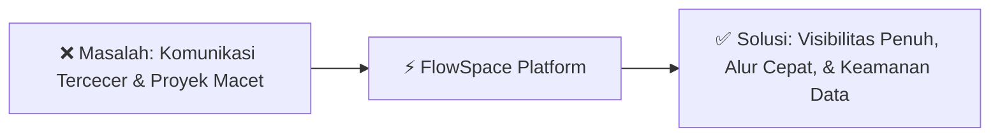

# FlowSpace

> **Organize Work. Move Forward.**  
> Modern, collaborative project management SaaS combining Trello's intuitive Kanban, Linear's sleek UX, and Jira's structured Agile workflows.

---

## 1. Project Overview

FlowSpace is a collaborative work management platform built for modern software engineering teams, designers, product managers, and startups. It provides a structured workspace hierarchy:

$$\text{Organization} \longrightarrow \text{Workspace} \longrightarrow \text{Project} \longrightarrow \text{Task}$$

### Core Capabilities
- **Multi-Tenant Organization & Workspace Isolation**
- **Agile Project Management & Customizable Kanban Boards**
- **Interactive Drag-and-Drop Task Management (dnd-kit)**
- **Session-based Secure HttpOnly Cookie Authentication**
- **Role-Based Access Control (RBAC)**
- **Task Discussions, Comments & Activity Audit Trail**

---

## 2. Masalah yang Diselesaikan (The Problems We Solve)

Dalam dunia pengembangan software dan manajemen produk modern, kegagalan proyek hampir tidak pernah disebabkan oleh kurangnya kemampuan teknis, melainkan oleh **fragmentasi komunikasi, perkakas yang lambat/rumit, dan hilangnya visibilitas alur kerja**. 

Sebagai *problem solver* profesional, FlowSpace dibangun secara presisi untuk menuntaskan 5 titik masalah kritis (*operational bottlenecks*) berikut:



### 🎯 5 Solusi Konkret yang Dihadirkan FlowSpace:

| Masalah Nyata di Lapangan (Pain Point) | Mengapa Ini Terjadi? | Solusi Profesional FlowSpace (Engineering Solution) |
| :--- | :--- | :--- |
| **1. Tugas Tercecer & Kehilangan Konteks *(SaaS Sprawl)*** | Tim menggunakan chat (Slack/WA) untuk instruksi, spreadsheet untuk tracking, dan catatan tempel. Konteks hilang saat tugas dieksekusi. | **Single Source of Truth:** Struktur hierarki bersih `Organisasi → Workspace → Project → Task`. Seluruh diskusi Markdown, dokumen, dan instruksi menempel langsung pada kartu task terkait. |
| **2. *"Jira Fatigue"* & Aplikasi Terlalu Berat** | Software manajemen proyek konvensional lambat, berbelit-belit (*bloated*), dan membebani mental tim sehingga anggota malas memperbarui status task. | **Linear-inspired Speed & Trello Simplicity:** Dibangun di atas Next.js 15+ App Router & Turbopack. Interaksi papan Kanban drag-and-drop (*dnd-kit*) terasa instan, mulus, dan menyenangkan digunakan setiap hari. |
| **3. Rapat Berulang & Status Check Fatigue** | Manajer dan Tech Lead membuang waktu 2–3 jam sehari hanya untuk bertanya *"Bagaimana progres fitur X?"* atau *"Siapa yang sedang mengerjakan bug Y?"*. | **Transparansi Visual & Audit Trail Lengkap:** Status Kanban berkode warna (To Do, In Progress, In Review, Done), label prioritas, avatar assignee, serta *Activity Log* otomatis yang merekam setiap perpindahan status secara transparan. |
| **4. Kebocoran Data Antar-Klien / Antar-Tim** | Agensi, konsultan, atau perusahaan multi-tim berisiko tinggi membocorkan data rahasia jika sistem perizinan tidak diisolasi secara ketat. | **Zero-Trust Multi-Tenant Architecture:** Setiap permintaan divalidasi hingga level transaksi database PostgreSQL. Kontraktor di Workspace A tidak akan pernah bisa mengintip Project di Workspace B berkat Role-Based Access Control (RBAC). |
| **5. Konflik Pembaruan & Data Hilang *(Race Condition)*** | Ketika dua orang mengedit status kartu task yang sama secara bersamaan di papan kolaboratif, salah satu perubahan bisa tertimpa (*lost update*). | **Optimistic Concurrency Control:** Didukung penguncian versi otomatis (`version-based optimistic locking`). Setiap perubahan diverifikasi sehingga integritas data proyek selalu terjaga 100%. |

> **Filosofi Produk Kami:** *"Make complex project management feel simple."*  
> Kami tidak sekadar menambahkan fitur; kami memangkas friksi operasional agar tim Anda bisa fokus menghasilkan karya terbaik secara cepat dan terukur.

---

## 3. Technology Stack

### Frontend
- **Framework:** Next.js (App Router)
- **Language:** TypeScript
- **Styling:** Tailwind CSS & shadcn/ui
- **State Management:** TanStack Query (Server State) & Zustand (UI State)
- **Forms & Validation:** React Hook Form & Zod
- **Drag-and-Drop:** dnd-kit

### Backend
- **Framework:** NestJS (Modular Monolith)
- **Language:** TypeScript
- **Database & ORM:** PostgreSQL & Prisma ORM
- **Authentication:** Server-side Sessions (Opaque Hashed Token in HttpOnly Cookies)
- **API Style:** REST API (`/api/v1`) with Swagger/OpenAPI Documentation

### Architecture & Infrastructure
- **Monorepo:** pnpm workspaces & Turborepo
- **Containerization:** Docker & Docker Compose
- **Object Storage (Phase 2):** Cloudflare R2

---

## 4. Repository Structure

```text
flowspace/
├── apps/
│   ├── web/                  # Next.js web application
│   └── api/                  # NestJS backend REST API
├── packages/
│   └── shared/               # Shared types, constants, and Zod schemas
├── docs/                     # Comprehensive product & technical documentation
├── docker/                   # Docker deployment configurations
├── AGENTS.md                 # Master instructions for AI coding agents
├── .env.example              # Environment variables template
├── .gitignore
├── package.json              # Monorepo root configuration
└── README.md
```

---

## 5. Documentation Index

Detailed specifications and architectural guides are maintained in the [`docs/`](./docs) directory:

| Document | Description |
|---|---|
| [docs/PRODUCT-VISION.md](./docs/PRODUCT-VISION.md) | Product vision, target users, and long-term roadmap |
| [docs/PRD.md](./docs/PRD.md) | Product Requirements Document (PRD) & feature specs |
| [docs/SYSTEM-ARCHITECTURE.md](./docs/SYSTEM-ARCHITECTURE.md) | System architecture, security model, and component layout |
| [docs/DATABASE-DESIGN.md](./docs/DATABASE-DESIGN.md) | Relational database schema, ERD, and Prisma specifications |
| [docs/API-SPECIFICATION.md](./docs/API-SPECIFICATION.md) | REST API endpoints, DTO contracts, and error responses |
| [docs/TASK-BREAKDOWN.md](./docs/TASK-BREAKDOWN.md) | Vertical slice development tasks from Phase 0 to Phase 8 |
| [docs/DESIGN-SYSTEM.md](./docs/DESIGN-SYSTEM.md) | UI Design tokens, dark/light theme palettes, and typography |
| [docs/USER-JOURNEY.md](./docs/USER-JOURNEY.md) | User personas, information architecture, and core user flows |
| [docs/USER-ROLES-PERMISSIONS.md](./docs/USER-ROLES-PERMISSIONS.md) | Multi-tenant RBAC permissions matrix |
| [AGENTS.md](./AGENTS.md) | Mandatory protocol and guidelines for AI coding agents |

---

## 6. Quick Start & Local Setup

### Prerequisites
- **Node.js:** >= 20.x
- **pnpm:** >= 9.x
- **PostgreSQL:** >= 16.x (or Docker)

### 1. Clone & Install Dependencies
```bash
git clone https://github.com/flowspace/flowspace.git
cd flowspace
pnpm install
```

### 2. Environment Configuration
Copy environment variable templates:
```bash
cp apps/api/.env.example apps/api/.env
cp apps/web/.env.example apps/web/.env
```

### 3. Database Initialization (Prisma)
```bash
# Generate Prisma Client & apply migrations
pnpm --filter @flowspace/api run prisma:generate
pnpm --filter @flowspace/api run prisma:migrate
```

### 4. Run Development Servers
```bash
pnpm run dev
```
- **Web Frontend:** [http://localhost:3000](http://localhost:3000)
- **REST API:** [http://localhost:3001/api/v1](http://localhost:3001/api/v1)
- **API Swagger Documentation:** [http://localhost:3001/api/docs](http://localhost:3001/api/docs)
- **Health Check:** [http://localhost:3001/api/v1/health](http://localhost:3001/api/v1/health)

### 5. Running with Docker Compose
```bash
cd docker
docker compose up -d
```

---

## 7. Testing & Quality Assurance

```bash
# Run all unit tests across monorepo
pnpm run test

# Run API unit & E2E integration test suites
pnpm --filter @flowspace/api run test
pnpm --filter @flowspace/api run test:e2e

# Run Web unit test suite
pnpm --filter @flowspace/web run test

# Run monorepo typecheck & lint
pnpm run lint

# Build production artifacts
pnpm run build
```

---

## 8. MVP Feature Status & Phase Matrix

| Phase | Milestone | Tasks Covered | Status |
|---|---|---|---|
| **Phase 0** | Monorepo & Tooling Setup | FS-001 – FS-005 | Completed |
| **Phase 1** | Authentication & Profile | FS-006 – FS-012 | Completed |
| **Phase 2** | Organization & Tenancy | FS-013 – FS-016 | Completed |
| **Phase 3** | Workspaces Management | FS-017 – FS-020 | Completed |
| **Phase 4** | Invitations & RBAC | FS-021 – FS-025 | Completed |
| **Phase 5** | Project Management | FS-026 – FS-031 | Completed |
| **Phase 6** | Task Management & Kanban Board | FS-032 – FS-040 | Completed |
| **Phase 7** | Collaboration (Comments, Activities, Notifications) | FS-041 – FS-046 | Completed |
| **Phase 8** | MVP Stabilization & Production Readiness | FS-047 – FS-049 | Completed |

---

## 9. Development Principles

All development on FlowSpace adheres to the following protocol defined in [AGENTS.md](./AGENTS.md):
- **Vertical Slice Development:** One task from [docs/TASK-BREAKDOWN.md](./docs/TASK-BREAKDOWN.md) at a time.
- **Strict Verification:** Type check, lint, and execute unit/integration tests before committing.
- **Rule of Work:** *One Task → One Implementation → One Verification → One Commit.*
