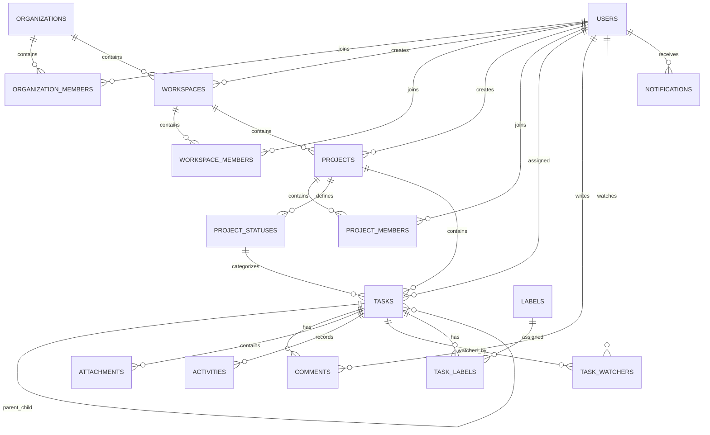
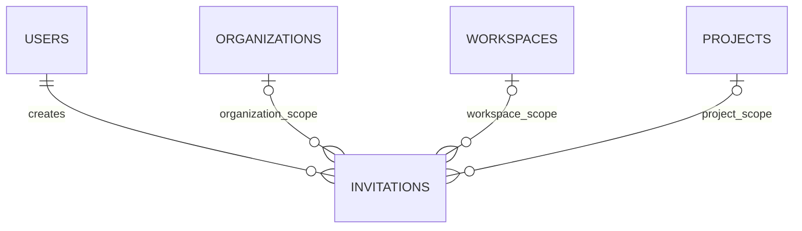

# FlowSpace — Database Design Document

**Version:** 1.0  
**Status:** Draft  
**Database:** PostgreSQL  
**ORM:** Prisma  
**Architecture:** Modular Monolith  
**Product:** Collaborative Project Management SaaS

---

# 1. Database Design Overview

## 1.1 Objective

Dokumen ini menjelaskan rancangan database FlowSpace sebagai dasar implementasi backend menggunakan NestJS, PostgreSQL, dan Prisma.

Tujuan utama:

- Menyediakan struktur database yang scalable.
- Mendukung multi-tenant architecture.
- Mendukung organization, workspace, project, dan task.
- Mendukung role-based access control.
- Menjaga integritas relasi antarentitas.
- Mendukung pengembangan fitur lanjutan.
- Menghindari duplikasi data.

## 1.2 Database Principles

1. PostgreSQL digunakan sebagai relational database utama.
2. Prisma digunakan sebagai ORM.
3. Setiap entitas memiliki primary key.
4. Foreign key digunakan untuk menjaga integritas relasi.
5. Unique constraints diterapkan pada data yang harus unik.
6. Indexes diterapkan pada kolom yang sering digunakan untuk pencarian dan filtering.
7. Timestamp menggunakan UTC.
8. Penghapusan data harus mengikuti kebijakan lifecycle setiap entitas.
9. Semua operasi yang membutuhkan perubahan beberapa tabel harus menggunakan database transaction.
10. Akses data harus selalu mempertimbangkan tenant dan permission.

---

# 2. Core Business Hierarchy

Struktur utama FlowSpace:

```text
USER
 │
 └── ORGANIZATION
       │
       ├── ORGANIZATION MEMBERS
       │
       └── WORKSPACE
             │
             ├── WORKSPACE MEMBERS
             │
             └── PROJECT
                   │
                   ├── PROJECT MEMBERS
                   │
                   ├── PROJECT STATUSES
                   │
                   ├── LABELS
                   │
                   └── TASKS
                         │
                         ├── SUBTASKS
                         ├── COMMENTS
                         ├── ATTACHMENTS
                         ├── ACTIVITIES
                         ├── WATCHERS
                         └── TASK LABELS
```

Satu user dapat menjadi anggota beberapa organization.

Satu organization dapat memiliki beberapa workspace.

Satu workspace dapat memiliki beberapa project.

Satu project dapat memiliki banyak task.

---

# 3. Entity List

## 3.1 Core Entities

| Entity | Purpose |
|---|---|
| User | Menyimpan informasi pengguna |
| Session | Mengelola autentikasi pengguna |
| EmailVerificationToken | Menyimpan token verifikasi email |
| PasswordResetToken | Menyimpan token reset password |
| Organization | Menyimpan organisasi |
| OrganizationMember | Menyimpan keanggotaan organisasi |
| Workspace | Menyimpan workspace |
| WorkspaceMember | Menyimpan keanggotaan workspace |
| Project | Menyimpan project |
| ProjectMember | Menyimpan keanggotaan project |
| Invitation | Mengelola undangan anggota |

## 3.2 Project Management Entities

| Entity | Purpose |
|---|---|
| ProjectStatus | Menyimpan workflow status |
| Task | Menyimpan pekerjaan |
| Label | Menyimpan label project |
| TaskLabel | Menghubungkan task dengan label |
| Comment | Menyimpan komentar task |
| TaskWatcher | Menyimpan pengguna yang mengikuti task |
| TaskDependency | Mengelola ketergantungan task |
| Attachment | Menyimpan metadata file |
| Activity | Menyimpan riwayat aktivitas |
| Notification | Menyimpan notifikasi pengguna |

---

# 4. Detailed Table Design

## 4.1 Users

Table: `users`

Menyimpan informasi pengguna FlowSpace.

| Column | Type | Constraint |
|---|---|---|
| id | UUID | Primary Key |
| name | VARCHAR(120) | NOT NULL |
| email | VARCHAR(255) | UNIQUE, NOT NULL |
| password_hash | TEXT | NOT NULL |
| avatar_url | TEXT | NULL |
| email_verified_at | TIMESTAMP | NULL |
| created_at | TIMESTAMP | NOT NULL |
| updated_at | TIMESTAMP | NOT NULL |
| deleted_at | TIMESTAMP | NULL |

Rules:
- Email harus unik.
- Password wajib disimpan dalam bentuk hash.
- Penghapusan akun menggunakan soft delete jika masih memiliki relasi bisnis yang perlu dipertahankan.
- Email dinormalisasi sebelum disimpan.

## 4.2 Sessions

Table: `sessions`

Menyimpan sesi autentikasi.

| Column | Type | Constraint |
|---|---|---|
| id | UUID | Primary Key |
| user_id | UUID | Foreign Key |
| token_hash | TEXT | UNIQUE, NOT NULL |
| expires_at | TIMESTAMP | NOT NULL |
| last_used_at | TIMESTAMP | NULL |
| created_at | TIMESTAMP | NOT NULL |
| revoked_at | TIMESTAMP | NULL |
| user_agent | TEXT | NULL |
| ip_address | INET | NULL |

Rules:
- Browser menerima opaque session token melalui secure HttpOnly cookie.
- Database hanya menyimpan hash token.
- Session dapat dicabut.
- Session yang sudah kedaluwarsa atau dicabut tidak dapat digunakan.
- Cookie menggunakan konfigurasi Secure, HttpOnly, dan SameSite yang sesuai.

## 4.3 Email Verification Tokens

Table: `email_verification_tokens`

Menyimpan token untuk verifikasi email pendaftaran akun baru.

| Column | Type | Constraint |
|---|---|---|
| id | UUID | Primary Key |
| user_id | UUID | Foreign Key |
| token_hash | TEXT | NOT NULL |
| expires_at | TIMESTAMP | NOT NULL |
| used_at | TIMESTAMP | NULL |
| created_at | TIMESTAMP | NOT NULL |

Rules:
- Token hanya berlaku satu kali pakai.
- Menyimpan hash token di database, bukan token mentah.
- Token memiliki masa berlaku kedaluwarsa.

## 4.4 Password Reset Tokens

Table: `password_reset_tokens`

Menyimpan token pemulihan password.

| Column | Type | Constraint |
|---|---|---|
| id | UUID | Primary Key |
| user_id | UUID | Foreign Key |
| token_hash | TEXT | NOT NULL |
| expires_at | TIMESTAMP | NOT NULL |
| used_at | TIMESTAMP | NULL |
| created_at | TIMESTAMP | NOT NULL |

Rules:
- Token hanya berlaku dalam jangka waktu singkat.
- Token langsung dicabut/ditandai `used_at` saat password berhasil diubah.

## 4.5 Organizations

Table: `organizations`

Menyimpan informasi organisasi.

| Column | Type | Constraint |
|---|---|---|
| id | UUID | Primary Key |
| name | VARCHAR(150) | NOT NULL |
| slug | VARCHAR(180) | UNIQUE, NOT NULL |
| description | TEXT | NULL |
| logo_url | TEXT | NULL |
| created_by | UUID | Foreign Key |
| created_at | TIMESTAMP | NOT NULL |
| updated_at | TIMESTAMP | NOT NULL |
| deleted_at | TIMESTAMP | NULL |

Rules:
- Organization dibuat oleh user yang terautentikasi.
- Creator otomatis menjadi Organization Owner.
- Slug digunakan untuk identifikasi URL.

## 4.6 Organization Members

Table: `organization_members`

Menghubungkan user dengan organization.

| Column | Type | Constraint |
|---|---|---|
| id | UUID | Primary Key |
| organization_id | UUID | Foreign Key |
| user_id | UUID | Foreign Key |
| role | ENUM | NOT NULL |
| joined_at | TIMESTAMP | NOT NULL |
| created_at | TIMESTAMP | NOT NULL |

Organization roles:

- OWNER
- ADMIN
- MEMBER

Constraints:
- UNIQUE (organization_id, user_id)
- Satu organization hanya memiliki satu Owner aktif.
- Owner tidak dapat menghapus dirinya sendiri sebelum memindahkan kepemilikan.
- Perubahan membership harus mematuhi aturan authorization.

## 4.7 Workspaces

Table: `workspaces`

| Column | Type | Constraint |
|---|---|---|
| id | UUID | Primary Key |
| organization_id | UUID | Foreign Key |
| name | VARCHAR(150) | NOT NULL |
| description | TEXT | NULL |
| slug | VARCHAR(180) | NOT NULL |
| created_by | UUID | Foreign Key |
| created_at | TIMESTAMP | NOT NULL |
| updated_at | TIMESTAMP | NOT NULL |
| archived_at | TIMESTAMP | NULL |

Constraints:
- UNIQUE (organization_id, slug)
- Workspace harus memiliki organization.
- Workspace tidak dapat berpindah organization melalui update biasa.

## 4.8 Workspace Members

Table: `workspace_members`

| Column | Type | Constraint |
|---|---|---|
| id | UUID | Primary Key |
| workspace_id | UUID | Foreign Key |
| user_id | UUID | Foreign Key |
| role | ENUM | NOT NULL |
| joined_at | TIMESTAMP | NOT NULL |
| created_at | TIMESTAMP | NOT NULL |

Workspace roles:

- OWNER
- ADMIN
- MEMBER
- VIEWER

Constraints:
- UNIQUE (workspace_id, user_id)
- User harus menjadi anggota organization terkait.
- Workspace Owner/Admin memiliki akses administratif ke project dalam workspace.

## 4.9 Projects

Table: `projects`

| Column | Type | Constraint |
|---|---|---|
| id | UUID | Primary Key |
| organization_id | UUID | Foreign Key |
| workspace_id | UUID | Foreign Key |
| name | VARCHAR(180) | NOT NULL |
| key | VARCHAR(20) | NOT NULL |
| description | TEXT | NULL |
| status | ENUM | NOT NULL |
| start_date | DATE | NULL |
| due_date | DATE | NULL |
| created_by | UUID | Foreign Key |
| created_at | TIMESTAMP | NOT NULL |
| updated_at | TIMESTAMP | NOT NULL |
| archived_at | TIMESTAMP | NULL |

Project statuses:

- PLANNING
- ACTIVE
- ON_HOLD
- COMPLETED
- CANCELLED

Constraints:
- UNIQUE (workspace_id, key)
- Project harus memiliki workspace.
- Organization ID harus sesuai dengan organization milik workspace.
- Project tidak dapat dipindahkan antar-workspace melalui update biasa.

## 4.10 Project Members

Table: `project_members`

| Column | Type | Constraint |
|---|---|---|
| id | UUID | Primary Key |
| project_id | UUID | Foreign Key |
| user_id | UUID | Foreign Key |
| role | ENUM | NOT NULL |
| joined_at | TIMESTAMP | NOT NULL |
| created_at | TIMESTAMP | NOT NULL |

Project roles:

- MANAGER
- MEMBER
- VIEWER

Constraints:
- UNIQUE (project_id, user_id)
- Project member harus memiliki workspace membership.
- Workspace Owner/Admin dan Organization Owner/Admin mendapatkan akses administratif melalui inheritance, bukan dengan membuat membership duplikat secara otomatis.

## 4.11 Invitations

Table: `invitations`

Satu tabel untuk seluruh jenis invitation.

| Column | Type | Constraint |
|---|---|---|
| id | UUID | Primary Key |
| email | VARCHAR(255) | NOT NULL |
| token_hash | TEXT | UNIQUE, NOT NULL |
| organization_id | UUID | Nullable FK |
| workspace_id | UUID | Nullable FK |
| project_id | UUID | Nullable FK |
| role | VARCHAR(30) | NOT NULL |
| status | ENUM | NOT NULL |
| invited_by | UUID | Foreign Key |
| expires_at | TIMESTAMP | NOT NULL |
| accepted_at | TIMESTAMP | NULL |
| created_at | TIMESTAMP | NOT NULL |
| revoked_at | TIMESTAMP | NULL |

Invitation statuses:

- PENDING
- ACCEPTED
- REJECTED
- EXPIRED
- REVOKED

Rules:
- Invitation harus memiliki tepat satu scope.
- Scope dapat berupa organization, workspace, atau project.
- Email harus sesuai dengan email akun yang menerima undangan.
- Token disimpan dalam bentuk hash.
- Invitation memiliki expiration.
- Invitation tidak dapat digunakan kembali setelah diterima.
- Invitation harus memvalidasi membership pada scope induknya.

---

# 5. Project Management Tables

## 5.1 Project Statuses

Table: `project_statuses`

Menyimpan workflow status untuk setiap project.

| Column | Type | Constraint |
|---|---|---|
| id | UUID | Primary Key |
| project_id | UUID | Foreign Key |
| name | VARCHAR(80) | NOT NULL |
| category | ENUM | NOT NULL |
| color | VARCHAR(20) | NOT NULL |
| position | INTEGER | NOT NULL |
| is_default | BOOLEAN | NOT NULL |
| created_at | TIMESTAMP | NOT NULL |
| updated_at | TIMESTAMP | NOT NULL |

Status categories:

- TODO
- IN_PROGRESS
- DONE

Setiap project baru secara default akan dibuatkan 5 status workflow:
1. `Backlog` (Category: `TODO`, Position: 0, Color: `#64748B`, is_default: false)
2. `Todo` (Category: `TODO`, Position: 1, Color: `#94A3B8`, is_default: true)
3. `In Progress` (Category: `IN_PROGRESS`, Position: 2, Color: `#3B82F6`, is_default: false)
4. `In Review` (Category: `IN_PROGRESS`, Position: 3, Color: `#F59E0B`, is_default: false)
5. `Done` (Category: `DONE`, Position: 4, Color: `#22C55E`, is_default: false)

Rules:
- Setiap project memiliki status default (`Todo`).
- Status dapat diubah, ditambah, dihapus, dan diurutkan posisinya.
- Status yang masih digunakan task tidak boleh langsung dihapus.
- Penghapusan status harus memindahkan task terkait ke status lain dalam satu transaction.

## 5.2 Tasks

Table: `tasks`

| Column | Type | Constraint |
|---|---|---|
| id | UUID | Primary Key |
| project_id | UUID | Foreign Key |
| status_id | UUID | Foreign Key |
| parent_task_id | UUID | Nullable Self FK |
| task_number | INTEGER | NOT NULL |
| title | VARCHAR(255) | NOT NULL |
| description | TEXT | NULL |
| priority | ENUM | NOT NULL |
| assignee_id | UUID | Nullable FK |
| start_date | DATE | NULL |
| due_date | DATE | NULL |
| position | DECIMAL(20, 10) | NOT NULL |
| version | INTEGER | NOT NULL DEFAULT 1 |
| created_by | UUID | Foreign Key |
| created_at | TIMESTAMP | NOT NULL |
| updated_at | TIMESTAMP | NOT NULL |
| completed_at | TIMESTAMP | NULL |
| deleted_at | TIMESTAMP | NULL |

Task priorities:

- LOW
- MEDIUM
- HIGH
- URGENT

Task identifier:

Format:

`PROJECTKEY-NUMBER`

Contoh:
- FLOW-1
- FLOW-2
- FLOW-3

Rules:
- Identifier unik dalam project (`UNIQUE(project_id, task_number)`).
- Task harus memiliki project.
- Status harus berasal dari project yang sama.
- Single Assignee untuk MVP: Task memiliki 1 penanggung jawab utama. Kolaborator tambahan mengikuti task melalui `task_watchers`.
- Assignee harus memiliki akses ke project.
- Subtask harus berada dalam project yang sama dengan parent task.
- Task tidak boleh menjadi parent dari dirinya sendiri.
- Circular subtask relationships harus dicegah.
- Task yang sudah selesai memiliki completed_at.
- Optimistic locking: Kolom `version` digunakan untuk mendeteksi konflik perubahan bersamaan (HTTP 409 Conflict) saat kartu dipindahkan atau diperbarui.
- Task tidak boleh menjadi parent dari dirinya sendiri.
- Circular subtask relationships harus dicegah.
- Task yang sudah selesai memiliki completed_at.

## 5.3 Labels

Table: `labels`

| Column | Type | Constraint |
|---|---|---|
| id | UUID | Primary Key |
| project_id | UUID | Foreign Key |
| name | VARCHAR(80) | NOT NULL |
| color | VARCHAR(20) | NOT NULL |
| created_at | TIMESTAMP | NOT NULL |

Constraints:
- UNIQUE (project_id, name)
- Label hanya berlaku dalam project terkait.

## 5.4 Task Labels

Table: `task_labels`

| Column | Type | Constraint |
|---|---|---|
| task_id | UUID | Foreign Key |
| label_id | UUID | Foreign Key |
| created_at | TIMESTAMP | NOT NULL |

Constraints:
- Composite Primary Key (task_id, label_id).

Task dan label harus berasal dari project yang sama.

## 5.5 Comments

Table: `comments`

| Column | Type | Constraint |
|---|---|---|
| id | UUID | Primary Key |
| task_id | UUID | Foreign Key |
| user_id | UUID | Foreign Key |
| content | TEXT | NOT NULL |
| created_at | TIMESTAMP | NOT NULL |
| updated_at | TIMESTAMP | NOT NULL |
| deleted_at | TIMESTAMP | NULL |

Rules:
- Comment harus terhubung dengan task.
- User hanya dapat mengedit komentarnya sendiri, kecuali terdapat permission khusus.
- Comment deletion menggunakan soft delete.

## 5.6 Task Watchers

Table: `task_watchers`

| Column | Type | Constraint |
|---|---|---|
| task_id | UUID | Foreign Key |
| user_id | UUID | Foreign Key |
| created_at | TIMESTAMP | NOT NULL |

Constraints:
- Composite Primary Key (task_id, user_id).

Rules:
- Watcher harus memiliki akses ke project.
- Watcher menerima notifikasi sesuai pengaturan.

## 5.7 Task Dependencies

Table: `task_dependencies`

| Column | Type | Constraint |
|---|---|---|
| id | UUID | Primary Key |
| task_id | UUID | Foreign Key |
| depends_on_task_id | UUID | Foreign Key |
| created_at | TIMESTAMP | NOT NULL |

Rules:
- Task tidak dapat bergantung pada dirinya sendiri.
- Duplicate dependency tidak diperbolehkan.
- Circular dependencies harus dicegah.
- Kedua task harus berasal dari project yang sama pada MVP.

## 5.8 Attachments

Table: `attachments`

| Column | Type | Constraint |
|---|---|---|
| id | UUID | Primary Key |
| task_id | UUID | Foreign Key |
| uploaded_by | UUID | Foreign Key |
| file_name | VARCHAR(255) | NOT NULL |
| storage_key | TEXT | NOT NULL |
| mime_type | VARCHAR(150) | NOT NULL |
| file_size | BIGINT | NOT NULL |
| created_at | TIMESTAMP | NOT NULL |
| deleted_at | TIMESTAMP | NULL |

Rules:
- File disimpan di object storage.
- Database hanya menyimpan metadata dan storage key.
- Download harus melalui pemeriksaan authorization.
- File size dan file type harus divalidasi.

## 5.9 Activities

Table: `activities`

| Column | Type | Constraint |
|---|---|---|
| id | UUID | Primary Key |
| organization_id | UUID | Foreign Key |
| project_id | UUID | Nullable FK |
| task_id | UUID | Nullable FK |
| actor_id | UUID | Foreign Key |
| action | VARCHAR(100) | NOT NULL |
| entity_type | VARCHAR(50) | NOT NULL |
| entity_id | UUID | NOT NULL |
| metadata | JSONB | NULL |
| created_at | TIMESTAMP | NOT NULL |

Contoh action:
- TASK_CREATED
- TASK_UPDATED
- TASK_STATUS_CHANGED
- TASK_ASSIGNED
- COMMENT_CREATED
- PROJECT_CREATED

Rules:
- Activity bersifat append-only.
- Metadata tidak boleh menyimpan password, session token, atau informasi rahasia.
- Akses activity mengikuti permission terhadap resource terkait.

## 5.10 Notifications

Table: `notifications`

| Column | Type | Constraint |
|---|---|---|
| id | UUID | Primary Key |
| user_id | UUID | Foreign Key |
| type | VARCHAR(100) | NOT NULL |
| title | VARCHAR(180) | NOT NULL |
| message | TEXT | NOT NULL |
| resource_type | VARCHAR(50) | NULL |
| resource_id | UUID | NULL |
| is_read | BOOLEAN | NOT NULL |
| read_at | TIMESTAMP | NULL |
| created_at | TIMESTAMP | NOT NULL |

Rules:
- Notification dimiliki satu user.
- User hanya dapat mengakses notifikasinya sendiri.
- Notification tidak boleh memberikan akses otomatis ke resource yang tidak dimiliki user.

---

# 6. Entity Relationship Diagram

## 6.1 Core ERD



## 6.2 Invitation ERD



Catatan: Diagram menggambarkan relasi konseptual. Validasi bahwa invitation hanya memiliki satu scope harus ditegakkan menggunakan database constraint dan application validation.

---

# 7. Relationship Rules

| Relationship | Type |
|---|---|
| User → Organization | Many-to-Many |
| Organization → Workspace | One-to-Many |
| User → Workspace | Many-to-Many |
| Workspace → Project | One-to-Many |
| User → Project | Many-to-Many |
| Project → Task | One-to-Many |
| Project → Project Status | One-to-Many |
| Task → Subtask | One-to-Many |
| Task → Comment | One-to-Many |
| Task → Attachment | One-to-Many |
| Task → Label | Many-to-Many |
| Task → Watcher | Many-to-Many |
| Task → Dependency | Many-to-Many |

---

# 8. Authorization & Membership Inheritance

## 8.1 Access Hierarchy

```text
Organization Owner
       │
       └── Full administrative access
              │
Organization Admin
       │
       └── Organization administration
              │
Workspace Owner/Admin
       │
       └── Workspace administration
              │
Project Manager
       │
       └── Project management
              │
Project Member
       │
       └── Task collaboration
              │
Project Viewer
       │
       └── Read-only access
```

Diagram ini menggambarkan tingkat akses konseptual, bukan hubungan pewarisan role secara otomatis.

## 8.2 Access Rules

1. Organization Owner/Admin dapat mengakses seluruh workspace dan project dalam organization untuk kebutuhan administrasi.
2. Workspace Owner/Admin dapat mengakses seluruh project dalam workspace.
3. Workspace Member/Viewer hanya dapat mengakses project yang memiliki project membership.
4. Project Manager dapat mengelola project sesuai permission.
5. Project Member dapat mengelola task sesuai permission.
6. Project Viewer memiliki akses baca.
7. User yang tidak memiliki akses organization tidak boleh membaca resource organization tersebut.

## 8.3 Important Security Rule

Jangan hanya memeriksa `userId` atau `role` dari frontend.

Setiap request backend harus memeriksa:

- User authentication.
- Organization membership.
- Workspace membership.
- Project membership.
- Resource ownership.
- Permission terhadap tindakan.

Authorization harus dilakukan pada server.

---

# 9. Database Constraints

## 9.1 Unique Constraints

| Table | Unique Constraint |
|---|---|
| Users | email |
| Sessions | token_hash |
| Organizations | slug |
| Organization Members | organization_id + user_id |
| Workspace Members | workspace_id + user_id |
| Workspaces | organization_id + slug |
| Projects | workspace_id + key |
| Project Members | project_id + user_id |
| Tasks | project_id + task_number |
| Labels | project_id + name |
| Task Labels | task_id + label_id |
| Task Watchers | task_id + user_id |
| Task Dependencies | task_id + depends_on_task_id |

## 9.2 Foreign Key Rules

- User deletion tidak boleh menyebabkan kehilangan riwayat bisnis secara tidak sengaja.
- Organization deletion harus mengikuti proses lifecycle yang jelas.
- Workspace deletion tidak boleh langsung menghapus project aktif tanpa konfirmasi dan aturan cascade yang jelas.
- Task deletion harus mempertimbangkan komentar, aktivitas, dan attachment.
- Membership deletion harus segera mencabut akses.
- Historical activity sebaiknya dipertahankan.

Gunakan `RESTRICT` atau soft deletion untuk relasi penting. Gunakan `CASCADE` hanya pada relasi yang benar-benar aman untuk dihapus bersama.

---

# 10. Indexing Strategy

Index yang direkomendasikan:

| Table | Index |
|---|---|
| Users | email |
| Sessions | user_id, expires_at |
| Organization Members | organization_id, user_id |
| Workspace Members | workspace_id, user_id |
| Projects | workspace_id, status |
| Project Members | project_id, user_id |
| Tasks | project_id, status_id |
| Tasks | project_id, assignee_id |
| Tasks | project_id, due_date |
| Tasks | project_id, position |
| Comments | task_id, created_at |
| Activities | organization_id, created_at |
| Notifications | user_id, is_read, created_at |
| Invitations | token_hash, status, expires_at |

Index harus disesuaikan dengan query aktual. Jangan menambahkan index secara berlebihan karena dapat memperlambat operasi write.

---

# 11. Transaction Requirements

Gunakan database transaction untuk operasi berikut:

1. Create organization + create owner membership.
2. Create workspace + create initial owner membership.
3. Accept invitation + create membership + update invitation status.
4. Create project + create initial statuses + create project manager membership.
5. Change task status + update task position + create activity.
6. Delete project status + migrate associated tasks.
7. Transfer organization ownership.

Operasi yang melibatkan beberapa tabel harus tetap konsisten meskipun salah satu langkah gagal.

---

# 12. MVP Database Scope

Tidak semua tabel harus diimplementasikan pada tahap pertama.

## Required for MVP

- users
- sessions
- organizations
- organization_members
- workspaces
- workspace_members
- projects
- project_members
- invitations
- project_statuses
- tasks
- labels
- task_labels
- comments
- activities
- notifications

## Prepared for Later Phases

- task_watchers
- task_dependencies
- attachments

Tabel lanjutan dapat ditambahkan ketika fitur terkait mulai dikembangkan.

---

# 13. Prisma Implementation Rules & Master Schema

## 13.1 General Rules

1. Gunakan UUID sebagai primary key.
2. Gunakan Prisma enums untuk role, status, dan priority.
3. Gunakan `@map` dan `@@map` jika membutuhkan snake_case pada database.
4. Gunakan `@relation` secara eksplisit.
5. Gunakan `@@unique` untuk composite unique constraints.
6. Gunakan `@@index` untuk query yang sering digunakan.
7. Jangan mengubah migration lama yang sudah digunakan bersama atau di production.
8. Buat migration baru untuk setiap perubahan schema.
9. Gunakan transaction untuk operasi multi-tabel.
10. Jangan menyimpan informasi sensitif dalam JSONB activity metadata.

## 13.2 Prisma Schema Specification

```prisma
datasource db {
  provider = "postgresql"
  url      = env("DATABASE_URL")
}

generator client {
  provider = "prisma-client-js"
}

enum OrganizationRole {
  OWNER
  ADMIN
  MEMBER
}

enum WorkspaceRole {
  OWNER
  ADMIN
  MEMBER
  VIEWER
}

enum ProjectRole {
  MANAGER
  MEMBER
  VIEWER
}

enum ProjectStatusCategory {
  TODO
  IN_PROGRESS
  DONE
}

enum ProjectLifecycleStatus {
  PLANNING
  ACTIVE
  ON_HOLD
  COMPLETED
  CANCELLED
}

enum TaskPriority {
  LOW
  MEDIUM
  HIGH
  URGENT
}

enum InvitationStatus {
  PENDING
  ACCEPTED
  REJECTED
  EXPIRED
  REVOKED
}

model User {
  id              String    @id @default(uuid()) @db.Uuid
  name            String    @db.VarChar(120)
  email           String    @unique @db.VarChar(255)
  passwordHash    String    @map("password_hash")
  avatarUrl       String?   @map("avatar_url")
  emailVerifiedAt DateTime? @map("email_verified_at") @db.Timestamptz
  createdAt       DateTime  @default(now()) @map("created_at") @db.Timestamptz
  updatedAt       DateTime  @updatedAt @map("updated_at") @db.Timestamptz
  deletedAt       DateTime? @map("deleted_at") @db.Timestamptz

  sessions                Session[]
  emailVerificationTokens EmailVerificationToken[]
  passwordResetTokens     PasswordResetToken[]
  organizationMemberships OrganizationMember[]
  workspaceMemberships   WorkspaceMember[]
  projectMemberships     ProjectMember[]
  assignedTasks          Task[]                  @relation("TaskAssignee")
  createdTasks           Task[]                  @relation("TaskCreator")
  comments               Comment[]
  taskWatchers           TaskWatcher[]
  attachments            Attachment[]
  activities             Activity[]
  notifications          Notification[]
  createdInvitations     Invitation[]            @relation("InvitedByUser")

  @@map("users")
}

model Session {
  id         String    @id @default(uuid()) @db.Uuid
  userId     String    @map("user_id") @db.Uuid
  tokenHash  String    @unique @map("token_hash")
  expiresAt  DateTime  @map("expires_at") @db.Timestamptz
  lastUsedAt DateTime? @map("last_used_at") @db.Timestamptz
  revokedAt  DateTime? @map("revoked_at") @db.Timestamptz
  userAgent  String?   @map("user_agent")
  ipAddress  String?   @map("ip_address")
  createdAt  DateTime  @default(now()) @map("created_at") @db.Timestamptz

  user User @relation(fields: [userId], references: [id], onDelete: Cascade)

  @@index([userId, expiresAt])
  @@map("sessions")
}

model EmailVerificationToken {
  id        String    @id @default(uuid()) @db.Uuid
  userId    String    @map("user_id") @db.Uuid
  tokenHash String    @unique @map("token_hash")
  expiresAt DateTime  @map("expires_at") @db.Timestamptz
  usedAt    DateTime? @map("used_at") @db.Timestamptz
  createdAt DateTime  @default(now()) @map("created_at") @db.Timestamptz

  user User @relation(fields: [userId], references: [id], onDelete: Cascade)

  @@index([tokenHash])
  @@map("email_verification_tokens")
}

model PasswordResetToken {
  id        String    @id @default(uuid()) @db.Uuid
  userId    String    @map("user_id") @db.Uuid
  tokenHash String    @unique @map("token_hash")
  expiresAt DateTime  @map("expires_at") @db.Timestamptz
  usedAt    DateTime? @map("used_at") @db.Timestamptz
  createdAt DateTime  @default(now()) @map("created_at") @db.Timestamptz

  user User @relation(fields: [userId], references: [id], onDelete: Cascade)

  @@index([tokenHash])
  @@map("password_reset_tokens")
}

model Organization {
  id          String    @id @default(uuid()) @db.Uuid
  name        String    @db.VarChar(150)
  slug        String    @unique @db.VarChar(180)
  description String?
  logoUrl     String?   @map("logo_url")
  createdBy   String    @map("created_by") @db.Uuid
  createdAt   DateTime  @default(now()) @map("created_at") @db.Timestamptz
  updatedAt   DateTime  @updatedAt @map("updated_at") @db.Timestamptz
  deletedAt   DateTime? @map("deleted_at") @db.Timestamptz

  members     OrganizationMember[]
  workspaces  Workspace[]
  invitations Invitation[]
  activities  Activity[]

  @@map("organizations")
}

model OrganizationMember {
  id             String           @id @default(uuid()) @db.Uuid
  organizationId String           @map("organization_id") @db.Uuid
  userId         String           @map("user_id") @db.Uuid
  role           OrganizationRole
  joinedAt       DateTime         @default(now()) @map("joined_at") @db.Timestamptz
  createdAt      DateTime         @default(now()) @map("created_at") @db.Timestamptz

  organization Organization @relation(fields: [organizationId], references: [id], onDelete: Cascade)
  user         User         @relation(fields: [userId], references: [id], onDelete: Cascade)

  @@unique([organizationId, userId])
  @@index([userId])
  @@map("organization_members")
}

model Workspace {
  id             String    @id @default(uuid()) @db.Uuid
  organizationId String    @map("organization_id") @db.Uuid
  name           String    @db.VarChar(150)
  description    String?
  slug           String    @db.VarChar(180)
  createdBy      String    @map("created_by") @db.Uuid
  createdAt      DateTime  @default(now()) @map("created_at") @db.Timestamptz
  updatedAt      DateTime  @updatedAt @map("updated_at") @db.Timestamptz
  archivedAt     DateTime? @map("archived_at") @db.Timestamptz

  organization Organization      @relation(fields: [organizationId], references: [id], onDelete: Cascade)
  members      WorkspaceMember[]
  projects     Project[]
  invitations  Invitation[]

  @@unique([organizationId, slug])
  @@index([organizationId])
  @@map("workspaces")
}

model WorkspaceMember {
  id          String        @id @default(uuid()) @db.Uuid
  workspaceId String        @map("workspace_id") @db.Uuid
  userId      String        @map("user_id") @db.Uuid
  role        WorkspaceRole
  joinedAt    DateTime      @default(now()) @map("joined_at") @db.Timestamptz
  createdAt   DateTime      @default(now()) @map("created_at") @db.Timestamptz

  workspace Workspace @relation(fields: [workspaceId], references: [id], onDelete: Cascade)
  user      User      @relation(fields: [userId], references: [id], onDelete: Cascade)

  @@unique([workspaceId, userId])
  @@index([userId])
  @@map("workspace_members")
}

model Project {
  id             String                 @id @default(uuid()) @db.Uuid
  organizationId String                 @map("organization_id") @db.Uuid
  workspaceId    String                 @map("workspace_id") @db.Uuid
  name           String                 @db.VarChar(180)
  key            String                 @db.VarChar(20)
  description    String?
  status         ProjectLifecycleStatus @default(PLANNING)
  startDate      DateTime?              @map("start_date") @db.Date
  dueDate        DateTime?              @map("due_date") @db.Date
  createdBy      String                 @map("created_by") @db.Uuid
  createdAt      DateTime               @default(now()) @map("created_at") @db.Timestamptz
  updatedAt      DateTime               @updatedAt @map("updated_at") @db.Timestamptz
  archivedAt     DateTime?              @map("archived_at") @db.Timestamptz

  workspace Workspace       @relation(fields: [workspaceId], references: [id], onDelete: Cascade)
  members   ProjectMember[]
  statuses  ProjectStatus[]
  tasks     Task[]
  labels    Label[]
  activities Activity[]
  invitations Invitation[]

  @@unique([workspaceId, key])
  @@index([workspaceId, status])
  @@map("projects")
}

model ProjectMember {
  id        String      @id @default(uuid()) @db.Uuid
  projectId String      @map("project_id") @db.Uuid
  userId    String      @map("user_id") @db.Uuid
  role      ProjectRole
  joinedAt  DateTime    @default(now()) @map("joined_at") @db.Timestamptz
  createdAt DateTime    @default(now()) @map("created_at") @db.Timestamptz

  project Project @relation(fields: [projectId], references: [id], onDelete: Cascade)
  user    User    @relation(fields: [userId], references: [id], onDelete: Cascade)

  @@unique([projectId, userId])
  @@index([userId])
  @@map("project_members")
}

model ProjectStatus {
  id        String                @id @default(uuid()) @db.Uuid
  projectId String                @map("project_id") @db.Uuid
  name      String                @db.VarChar(80)
  category  ProjectStatusCategory
  color     String                @db.VarChar(20)
  position  Int
  isDefault Boolean               @default(false) @map("is_default")
  createdAt DateTime              @default(now()) @map("created_at") @db.Timestamptz
  updatedAt DateTime              @updatedAt @map("updated_at") @db.Timestamptz

  project Project @relation(fields: [projectId], references: [id], onDelete: Cascade)
  tasks   Task[]

  @@index([projectId, position])
  @@map("project_statuses")
}

model Task {
  id           String       @id @default(uuid()) @db.Uuid
  projectId    String       @map("project_id") @db.Uuid
  statusId     String       @map("status_id") @db.Uuid
  parentTaskId String?      @map("parent_task_id") @db.Uuid
  taskNumber   Int          @map("task_number")
  title        String       @db.VarChar(255)
  description  String?
  priority     TaskPriority @default(MEDIUM)
  assigneeId   String?      @map("assignee_id") @db.Uuid
  startDate    DateTime?    @map("start_date") @db.Date
  dueDate      DateTime?    @map("due_date") @db.Date
  position     Decimal      @db.Decimal(20, 10)
  version      Int          @default(1)
  createdBy    String       @map("created_by") @db.Uuid
  createdAt    DateTime     @default(now()) @map("created_at") @db.Timestamptz
  updatedAt    DateTime     @updatedAt @map("updated_at") @db.Timestamptz
  completedAt  DateTime?    @map("completed_at") @db.Timestamptz
  deletedAt    DateTime?    @map("deleted_at") @db.Timestamptz

  project    Project         @relation(fields: [projectId], references: [id], onDelete: Cascade)
  status     ProjectStatus   @relation(fields: [statusId], references: [id])
  assignee   User?           @relation("TaskAssignee", fields: [assigneeId], references: [id])
  creator    User            @relation("TaskCreator", fields: [createdBy], references: [id])
  parentTask Task?           @relation("TaskSubtasks", fields: [parentTaskId], references: [id], onDelete: SetNull)
  subtasks   Task[]          @relation("TaskSubtasks")
  labels     TaskLabel[]
  comments   Comment[]
  watchers   TaskWatcher[]
  dependencies TaskDependency[] @relation("TaskRequires")
  dependentOn  TaskDependency[] @relation("TaskDependsOn")
  attachments  Attachment[]
  activities   Activity[]

  @@unique([projectId, taskNumber])
  @@index([projectId, statusId, position])
  @@index([assigneeId, statusId])
  @@map("tasks")
}

model Label {
  id        String   @id @default(uuid()) @db.Uuid
  projectId String   @map("project_id") @db.Uuid
  name      String   @db.VarChar(80)
  color     String   @db.VarChar(20)
  createdAt DateTime @default(now()) @map("created_at") @db.Timestamptz

  project Project     @relation(fields: [projectId], references: [id], onDelete: Cascade)
  tasks   TaskLabel[]

  @@unique([projectId, name])
  @@map("labels")
}

model TaskLabel {
  taskId    String   @map("task_id") @db.Uuid
  labelId   String   @map("label_id") @db.Uuid
  createdAt DateTime @default(now()) @map("created_at") @db.Timestamptz

  task  Task  @relation(fields: [taskId], references: [id], onDelete: Cascade)
  label Label @relation(fields: [labelId], references: [id], onDelete: Cascade)

  @@id([taskId, labelId])
  @@map("task_labels")
}

model Comment {
  id        String    @id @default(uuid()) @db.Uuid
  taskId    String    @map("task_id") @db.Uuid
  userId    String    @map("user_id") @db.Uuid
  content   String
  createdAt DateTime  @default(now()) @map("created_at") @db.Timestamptz
  updatedAt DateTime  @updatedAt @map("updated_at") @db.Timestamptz
  deletedAt DateTime? @map("deleted_at") @db.Timestamptz

  task Task @relation(fields: [taskId], references: [id], onDelete: Cascade)
  user User @relation(fields: [userId], references: [id], onDelete: Cascade)

  @@index([taskId, createdAt])
  @@map("comments")
}

model TaskWatcher {
  taskId    String   @map("task_id") @db.Uuid
  userId    String   @map("user_id") @db.Uuid
  createdAt DateTime @default(now()) @map("created_at") @db.Timestamptz

  task Task @relation(fields: [taskId], references: [id], onDelete: Cascade)
  user User @relation(fields: [userId], references: [id], onDelete: Cascade)

  @@id([taskId, userId])
  @@map("task_watchers")
}

model TaskDependency {
  id               String   @id @default(uuid()) @db.Uuid
  taskId           String   @map("task_id") @db.Uuid
  dependsOnTaskId  String   @map("depends_on_task_id") @db.Uuid
  createdAt        DateTime @default(now()) @map("created_at") @db.Timestamptz

  task        Task @relation("TaskRequires", fields: [taskId], references: [id], onDelete: Cascade)
  dependsOn   Task @relation("TaskDependsOn", fields: [dependsOnTaskId], references: [id], onDelete: Cascade)

  @@unique([taskId, dependsOnTaskId])
  @@map("task_dependencies")
}

model Attachment {
  id          String    @id @default(uuid()) @db.Uuid
  taskId      String    @map("task_id") @db.Uuid
  uploadedBy  String    @map("uploaded_by") @db.Uuid
  fileName    String    @map("file_name") @db.VarChar(255)
  storageKey  String    @map("storage_key")
  mimeType    String    @map("mime_type") @db.VarChar(150)
  fileSize    BigInt    @map("file_size")
  createdAt   DateTime  @default(now()) @map("created_at") @db.Timestamptz
  deletedAt   DateTime? @map("deleted_at") @db.Timestamptz

  task     Task @relation(fields: [taskId], references: [id], onDelete: Cascade)
  uploader User @relation(fields: [uploadedBy], references: [id])

  @@index([taskId])
  @@map("attachments")
}

model Activity {
  id             String    @id @default(uuid()) @db.Uuid
  organizationId String    @map("organization_id") @db.Uuid
  projectId      String?   @map("project_id") @db.Uuid
  taskId         String?   @map("task_id") @db.Uuid
  actorId        String    @map("actor_id") @db.Uuid
  action         String    @db.VarChar(100)
  entityType     String    @map("entity_type") @db.VarChar(50)
  entityId       String    @map("entity_id") @db.Uuid
  metadata       Json?
  createdAt      DateTime  @default(now()) @map("created_at") @db.Timestamptz

  organization Organization @relation(fields: [organizationId], references: [id], onDelete: Cascade)
  project      Project?     @relation(fields: [projectId], references: [id], onDelete: SetNull)
  task         Task?        @relation(fields: [taskId], references: [id], onDelete: SetNull)
  actor        User         @relation(fields: [actorId], references: [id])

  @@index([organizationId, createdAt])
  @@index([taskId, createdAt])
  @@map("activities")
}

model Notification {
  id           String    @id @default(uuid()) @db.Uuid
  userId       String    @map("user_id") @db.Uuid
  type         String    @db.VarChar(100)
  title        String    @db.VarChar(180)
  message      String
  resourceType String?   @map("resource_type") @db.VarChar(50)
  resourceId   String?   @map("resource_id") @db.Uuid
  isRead       Boolean   @default(false) @map("is_read")
  readAt       DateTime? @map("read_at") @db.Timestamptz
  createdAt    DateTime  @default(now()) @map("created_at") @db.Timestamptz

  user User @relation(fields: [userId], references: [id], onDelete: Cascade)

  @@index([userId, isRead, createdAt])
  @@map("notifications")
}

model Invitation {
  id             String           @id @default(uuid()) @db.Uuid
  email          String           @db.VarChar(255)
  tokenHash      String           @unique @map("token_hash")
  organizationId String?          @map("organization_id") @db.Uuid
  workspaceId    String?          @map("workspace_id") @db.Uuid
  projectId      String?          @map("project_id") @db.Uuid
  role           String           @db.VarChar(30)
  status         InvitationStatus @default(PENDING)
  invitedBy      String           @map("invited_by") @db.Uuid
  expiresAt      DateTime         @map("expires_at") @db.Timestamptz
  acceptedAt     DateTime?        @map("accepted_at") @db.Timestamptz
  revokedAt      DateTime?        @map("revoked_at") @db.Timestamptz
  createdAt      DateTime         @default(now()) @map("created_at") @db.Timestamptz

  organization Organization? @relation(fields: [organizationId], references: [id], onDelete: Cascade)
  workspace    Workspace?    @relation(fields: [workspaceId], references: [id], onDelete: Cascade)
  project      Project?      @relation(fields: [projectId], references: [id], onDelete: Cascade)
  inviter      User          @relation("InvitedByUser", fields: [invitedBy], references: [id])

  @@index([tokenHash, status])
  @@index([email, status])
  @@map("invitations")
}
```

---

# 14. Important Technical Decisions

Keputusan yang harus dipertahankan:

| Topic | Decision |
|---|---|
| Database | PostgreSQL |
| ORM | Prisma |
| Primary Key | UUID |
| Tenant Model | Organization-based |
| Authentication | Server-side sessions |
| Session Storage | Hashed opaque token |
| Membership | Explicit membership tables |
| Authorization | Backend RBAC + resource checks |
| Project Workflow | Configurable project statuses |
| Task Identifier | Project key + sequence |
| Task Position | Numeric ordering |
| Activity | Append-only records |
| File Storage | External object storage |
| Deletion Strategy | Soft delete for important business data |

---

# 15. Implementation Checklist

Sebelum database dianggap siap:

- [ ] Semua entitas utama sudah ditentukan.
- [ ] Semua relationship sudah diperiksa.
- [ ] Unique constraints sudah ditentukan.
- [ ] Foreign keys sudah ditentukan.
- [ ] Indexes sudah ditentukan.
- [ ] Tenant isolation sudah dirancang.
- [ ] Membership inheritance sudah didefinisikan.
- [ ] Invitation scope sudah didefinisikan.
- [ ] Deletion policy sudah ditentukan.
- [ ] Transaction requirements sudah ditentukan.
- [ ] Prisma schema sudah divalidasi.
- [ ] Initial migration berhasil.
- [ ] Database ERD sesuai dengan implementasi.

---

# 16. Final Database Principle

Database FlowSpace harus dirancang berdasarkan kebutuhan bisnis dan aturan akses, bukan sekadar mengikuti tampilan UI.

**Satu sumber data untuk setiap entitas. Satu aturan akses yang konsisten. Tidak ada akses lintas tenant tanpa otorisasi.**