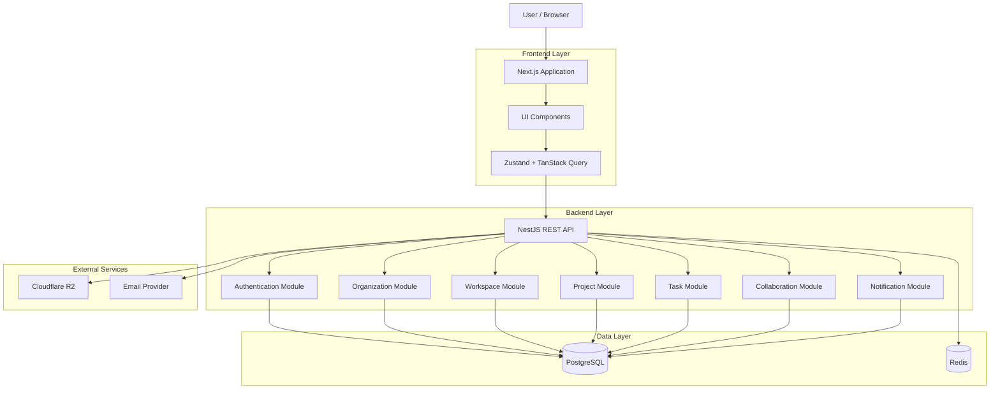

# FlowSpace — System Architecture Document

**Version:** 1.0  
**Status:** Draft  
**Architecture:** Modular Monolith  
**Repository:** Monorepo  
**Frontend:** Next.js  
**Backend:** NestJS  
**Database:** PostgreSQL  
**ORM:** Prisma

---

# 1. Architecture Overview

## 1.1 Architecture Objective

System Architecture Document menjelaskan struktur teknis FlowSpace, hubungan antarkomponen, aliran data, pembagian tanggung jawab, dan standar implementasi.

Tujuan arsitektur:

- Memisahkan frontend dan backend.
- Menjaga modularitas kode.
- Mendukung multi-tenant architecture.
- Mempermudah pengembangan fitur.
- Menjaga keamanan data.
- Mendukung pengembangan jangka panjang.
- Mempermudah integrasi layanan eksternal.

## 1.2 Architecture Pattern

FlowSpace menggunakan:

**Modular Monolith + Monorepo Architecture.**

Modular Monolith berarti backend berada dalam satu aplikasi NestJS, tetapi setiap domain bisnis dipisahkan ke dalam modul yang memiliki tanggung jawab jelas.

Monorepo berarti frontend, backend, dan shared packages berada dalam satu repository.

Alasan pemilihan:

1. Lebih mudah dikembangkan oleh satu developer.
2. Lebih sederhana untuk debugging.
3. Tidak memerlukan komunikasi antarmicroservice.
4. Deployment lebih mudah.
5. Modul dapat dipisahkan menjadi service berbeda jika kebutuhan bisnis benar-benar menuntutnya.

---

# 2. Technology Stack

## 2.1 Frontend

| Technology | Responsibility |
|---|---|
| Next.js | Web application |
| TypeScript | Type safety |
| Tailwind CSS | Styling |
| shadcn/ui | UI components |
| Zustand | Client state |
| TanStack Query | Server state |
| React Hook Form | Form management |
| Zod | Schema validation |
| dnd-kit | Drag and drop |
| Socket.IO Client | Real-time communication |

## 2.2 Backend

| Technology | Responsibility |
|---|---|
| NestJS | Backend framework |
| TypeScript | Type safety |
| Prisma | Database ORM |
| PostgreSQL | Primary database |
| Redis | Cache and temporary data |
| Socket.IO | Real-time communication |
| BullMQ | Background jobs |
| Jest | Backend testing |
| Swagger | API documentation |

## 2.3 Infrastructure

| Technology | Responsibility |
|---|---|
| Docker | Local development environment |
| Cloudflare R2 | File storage |
| GitHub | Source control |
| GitHub Actions | CI |
| Playwright | End-to-end testing |

Catatan: Tidak semua teknologi harus diaktifkan pada fase pertama. Redis, BullMQ, Socket.IO, dan Cloudflare R2 ditambahkan ketika fitur yang membutuhkannya mulai dikembangkan.

---

# 3. High-Level System Architecture



---

# 4. Repository Architecture

Struktur repository:

```text
flowspace/
│
├── apps/
│   │
│   ├── web/
│   │   ├── src/
│   │   │   ├── app/
│   │   │   ├── components/
│   │   │   ├── features/
│   │   │   ├── hooks/
│   │   │   ├── lib/
│   │   │   ├── providers/
│   │   │   ├── stores/
│   │   │   └── styles/
│   │   │
│   │   ├── public/
│   │   ├── tests/
│   │   └── package.json
│   │
│   └── api/
│       ├── src/
│       │   ├── modules/
│       │   ├── common/
│       │   ├── config/
│       │   ├── database/
│       │   ├── integrations/
│       │   └── main.ts
│       │
│       ├── test/
│       └── package.json
│
├── packages/
│   └── shared/
│       ├── src/
│       │   ├── types/
│       │   ├── constants/
│       │   └── schemas/
│       └── package.json
│
├── docs/
│
├── docker/
│
├── .github/
│   └── workflows/
│
├── package.json
├── pnpm-workspace.yaml
├── turbo.json
├── docker-compose.yml
├── AGENTS.md
├── .env.example
├── .gitignore
└── README.md
```

Gunakan pnpm sebagai package manager dan Turborepo untuk mengelola task monorepo jika diperlukan.

Shared package hanya digunakan untuk tipe dan kontrak yang benar-benar aman dibagikan. Jangan mengimpor kode backend yang sensitif ke frontend.

---

# 5. Frontend Architecture

## 5.1 Frontend Responsibilities

Next.js bertanggung jawab atas:

- Rendering UI.
- Routing.
- Form interaction.
- Client-side navigation.
- Display data dari backend.
- Loading and error states.
- Optimistic updates.
- Real-time UI updates.

Frontend tidak menjadi sumber kebenaran untuk authorization.

## 5.2 App Router Structure

```text
apps/web/src/app/
│
├── (auth)/
│   ├── login/
│   ├── register/
│   ├── forgot-password/
│   └── reset-password/
│
├── (app)/
│   ├── dashboard/
│   ├── my-tasks/
│   ├── inbox/
│   ├── workspaces/
│   ├── projects/
│   ├── members/
│   └── settings/
│
├── invitations/
│   └── accept/
│
├── layout.tsx
└── globals.css
```

## 5.3 Feature-Based Architecture

Setiap domain UI ditempatkan dalam feature folder.

Contoh:

```text
features/
│
├── authentication/
├── organizations/
├── workspaces/
├── projects/
├── tasks/
├── kanban/
├── collaboration/
└── notifications/
```

Setiap feature dapat memiliki:

- Components.
- Hooks.
- API functions.
- Types.
- Validation schemas.
- Tests.

Tujuannya agar komponen tidak menumpuk dalam satu folder besar.

## 5.4 State Management

Gunakan Zustand untuk client state seperti:

- Sidebar state.
- Modal state.
- Active organization.
- Active workspace.
- Temporary UI preferences.

Gunakan TanStack Query untuk server state seperti:

- Projects.
- Tasks.
- Members.
- Notifications.
- Comments.

Jangan menyimpan semua data server ke Zustand. Hindari dua sumber data yang tidak sinkron.

---

# 6. Backend Architecture

## 6.1 Backend Responsibilities

NestJS bertanggung jawab atas:

- Business logic.
- Authentication.
- Authorization.
- Data validation.
- Database access.
- API responses.
- Background processing.
- Real-time communication.

Semua business rules harus ditegakkan oleh backend.

## 6.2 Modular Structure

```text
apps/api/src/modules/
│
├── auth/
│   ├── auth.module.ts
│   ├── auth.controller.ts
│   ├── auth.service.ts
│   ├── auth.repository.ts
│   ├── dto/
│   └── guards/
│
├── users/
├── organizations/
├── workspaces/
├── invitations/
├── projects/
├── tasks/
├── comments/
├── activities/
├── notifications/
└── attachments/
```

## 6.3 Module Responsibilities

| Module | Responsibility |
|---|---|
| Auth | Authentication and sessions |
| Users | User profiles |
| Organizations | Organization management |
| Workspaces | Workspace management |
| Invitations | Member invitations |
| Projects | Project management |
| Tasks | Task management |
| Comments | Task discussions |
| Activities | Activity tracking |
| Notifications | User notifications |
| Attachments | File metadata and access |

## 6.4 Request Flow

```text
HTTP Request
     ↓
Controller
     ↓
Authentication Guard
     ↓
Validation Pipe
     ↓
Authorization Check
     ↓
Service
     ↓
Repository / Prisma
     ↓
PostgreSQL
     ↓
Response
```

Controller tidak boleh memuat business logic yang kompleks.

Service mengatur business rules.

Repository mengelola akses database apabila pemisahan repository memberikan manfaat nyata.

Jangan membuat abstraction yang tidak dibutuhkan hanya untuk mengikuti pola tertentu.

---

# 7. Authentication Architecture

## 7.1 Authentication Strategy

FlowSpace menggunakan server-side session dengan opaque token.

Alur:

1. User melakukan login.
2. Backend memverifikasi password.
3. Backend menghasilkan session token acak.
4. Backend menyimpan hash token di database.
5. Browser menerima token melalui secure HttpOnly cookie.
6. Setiap request membawa cookie.
7. Backend memvalidasi session.
8. Logout mencabut session.

## 7.2 Security Configuration

Cookie:
- HttpOnly.
- Secure pada production.
- SameSite sesuai deployment.
- Path dibatasi jika memungkinkan.

Tambahan:
- Password hashing menggunakan Argon2id.
- Rate limiting pada login.
- Session expiration.
- Session revocation.
- CSRF protection sesuai konfigurasi cookie.
- Reset password menggunakan token sekali pakai.

## 7.3 Important Rule

Jangan menyimpan session token di localStorage.

Jangan mengandalkan frontend untuk memeriksa apakah user masih memiliki akses.

---

# 8. Multi-Tenant Architecture

Organization merupakan batas utama kepemilikan data.

Contoh:

```text
Organization A
    ├── Workspace A1
    │     ├── Project A
    │     └── Project B
    │
    └── Workspace A2
          └── Project C

Organization B
    └── Workspace B1
          └── Project D
```

Data Organization A tidak boleh dapat diakses oleh user Organization B tanpa membership yang sah.

## 8.1 Tenant Isolation Rules

Setiap request resource harus memvalidasi:

1. User telah terautentikasi.
2. Resource benar-benar ada.
3. Resource termasuk organization yang dimaksud.
4. User memiliki membership atau akses administratif.
5. User memiliki permission terhadap tindakan.

Jangan hanya mengandalkan UUID yang sulit ditebak. UUID bukan pengganti authorization.

## 8.2 Resource Access

Contoh:

Ketika user mengakses:

`GET /api/v1/projects/:projectId`

Backend harus:
- Mengambil project.
- Mengidentifikasi organization.
- Memeriksa organization membership.
- Memeriksa workspace membership jika relevan.
- Memeriksa project membership atau akses administratif.
- Mengembalikan data hanya jika akses valid.

## 8.3 Database Security

Gunakan foreign key dan composite constraints untuk menjaga konsistensi relasi lintas tenant.

Row Level Security PostgreSQL dapat dipertimbangkan sebagai lapisan pertahanan tambahan setelah mekanisme aplikasi matang dan telah diuji.

---

# 9. API Communication Architecture

## 9.1 Communication Pattern

Frontend berkomunikasi dengan backend menggunakan REST API.

Base URL:

`/api/v1`

Contoh:

```text
POST   /api/v1/auth/login

GET    /api/v1/organizations

POST   /api/v1/workspaces

GET    /api/v1/projects

POST   /api/v1/projects

GET    /api/v1/tasks

POST   /api/v1/tasks
```

## 9.2 API Standards

Setiap endpoint harus memiliki:

- Request validation.
- Authentication jika diperlukan.
- Authorization jika diperlukan.
- Consistent response format.
- Error handling.
- API documentation.

Gunakan Swagger/OpenAPI untuk dokumentasi endpoint.

## 9.3 API Versioning

Gunakan:

`/api/v1`

Perubahan breaking yang signifikan dapat menggunakan versi baru ketika diperlukan.

---

# 10. Real-Time Architecture

Real-time functionality tidak wajib untuk MVP awal.

Pada fase lanjutan, gunakan Socket.IO.

## 10.1 Event Examples

```text
task.created
task.updated
task.deleted
task.status_changed
task.assigned
comment.created
notification.created
```

## 10.2 Room Structure

Contoh:

```text
organization:{organizationId}
workspace:{workspaceId}
project:{projectId}
user:{userId}
```

## 10.3 Security Rules

- Socket connection harus diautentikasi.
- Room membership harus divalidasi backend.
- User hanya boleh bergabung dengan room yang dapat diaksesnya.
- Event tidak boleh mengirim data sensitif.
- Akses harus diperiksa kembali ketika membership dicabut.

Jangan menganggap room ID sebagai bukti authorization.

---

# 11. Redis Architecture

Redis digunakan ketika kebutuhan sudah muncul.

Use cases:

- Caching.
- Rate limiting.
- Temporary tokens.
- Socket.IO scaling.
- Background job coordination.

Jangan menggunakan Redis sebagai sumber utama data project atau task.

PostgreSQL tetap menjadi sumber kebenaran.

---

# 12. Background Job Architecture

BullMQ digunakan untuk pekerjaan yang tidak harus diselesaikan dalam HTTP request.

Contoh:

- Mengirim invitation email.
- Mengirim email notification.
- Membersihkan expired sessions.
- Membersihkan expired invitations.
- Memproses file.
- Mengirim scheduled reminders.

Alur:

```text
API Request
    ↓
NestJS Service
    ↓
BullMQ Queue
    ↓
Redis
    ↓
Worker
    ↓
External Service
```

Job harus memiliki retry policy, error logging, dan idempotency yang sesuai.

---

# 13. File Storage Architecture

Gunakan Cloudflare R2 untuk file storage ketika attachment mulai diimplementasikan.

Flow:

1. User meminta upload authorization.
2. Backend memeriksa akses task.
3. Backend menghasilkan presigned upload URL.
4. Browser mengunggah file ke R2.
5. Backend memvalidasi hasil upload.
6. Metadata file disimpan di PostgreSQL.

File tidak disimpan sebagai binary dalam database.

Download harus melalui URL yang masa berlakunya terbatas dan hanya diterbitkan setelah authorization berhasil.

---

# 14. Error Handling

Backend menggunakan format error konsisten.

Contoh:

```json
{
  "success": false,
  "error": {
    "code": "RESOURCE_FORBIDDEN",
    "message": "You do not have permission to access this resource"
  }
}
```

Frontend harus menangani:
- Validation errors.
- Authentication errors.
- Authorization errors.
- Not found.
- Conflict.
- Rate limit.
- Server errors.

Jangan mengirim stack trace atau detail internal database kepada pengguna.

---

# 15. Testing Architecture

## 15.1 Unit Testing

Gunakan Jest untuk menguji:
- Services.
- Business rules.
- Permission logic.
- Validation.
- Utility functions.

## 15.2 Integration Testing

Uji:
- Database operations.
- API endpoints.
- Authentication.
- Membership.
- Invitation lifecycle.
- Task operations.

Gunakan database test terisolasi.

## 15.3 End-to-End Testing

Gunakan Playwright untuk menguji:

1. Register.
2. Login.
3. Create organization.
4. Create workspace.
5. Invite member.
6. Accept invitation.
7. Create project.
8. Create task.
9. Assign task.
10. Change task status.
11. Add comment.

## 15.4 Security Testing

Prioritaskan:
- IDOR.
- Cross-tenant access.
- Role escalation.
- Session hijacking mitigation.
- CSRF.
- Unauthorized file access.
- Invitation token reuse.

---

# 16. Deployment Architecture

Target deployment awal:

```text
             INTERNET
                 │
                 ▼
            HTTPS DOMAIN
                 │
        ┌────────┴────────┐
        ▼                 ▼
   NEXT.JS WEB       NESTJS API
                          │
                 ┌────────┴────────┐
                 ▼                 ▼
             POSTGRESQL          REDIS
                 │                 │
                 └────────┬────────┘
                          ▼
                    BACKGROUND
                       WORKER

                 EXTERNAL SERVICES
                    ├── R2
                    └── Email
```

Frontend dan backend dapat di-deploy terpisah.

PostgreSQL harus memiliki backup dan akses jaringan yang dibatasi.

Redis tidak boleh diekspos langsung ke internet.

Production harus menggunakan HTTPS.

---

# 17. Environment Configuration

Contoh `.env.example`:

```env
NODE_ENV=development

DATABASE_URL=

REDIS_URL=

WEB_URL=http://localhost:3000

API_URL=http://localhost:3001

SESSION_COOKIE_NAME=flowspace_session

SESSION_SECRET=

R2_ACCOUNT_ID=
R2_ACCESS_KEY_ID=
R2_SECRET_ACCESS_KEY=
R2_BUCKET_NAME=

EMAIL_HOST=
EMAIL_PORT=
EMAIL_USER=
EMAIL_PASSWORD=
EMAIL_FROM=
```

Jangan memasukkan secret asli ke repository.

Gunakan environment variables terpisah untuk development, testing, dan production.

---

# 18. Development Architecture Rules

1. Backend adalah sumber kebenaran untuk business rules.
2. Frontend tidak menentukan permission.
3. PostgreSQL adalah sumber kebenaran data.
4. Redis hanya digunakan untuk cache dan koordinasi.
5. Modular monolith dipertahankan.
6. Setiap modul memiliki tanggung jawab jelas.
7. Tidak ada akses database langsung dari frontend.
8. Setiap API memiliki validasi.
9. Setiap operasi sensitif memiliki authorization.
10. Semua perubahan database menggunakan migration.
11. Real-time event harus mengikuti authorization.
12. File storage harus melewati pemeriksaan akses.
13. Semua fitur harus memiliki testing sesuai tingkat risikonya.

---

# 19. Architecture Implementation Priority

| Component | Priority | Phase |
|---|---|---|
| Monorepo | Critical | Phase 0 |
| Next.js | Critical | Phase 0 |
| NestJS | Critical | Phase 0 |
| PostgreSQL | Critical | Phase 0 |
| Prisma | Critical | Phase 0 |
| REST API | Critical | Phase 0 |
| Authentication | Critical | Phase 1 |
| RBAC | Critical | Phase 2–3 |
| Redis | Later | Phase 10 |
| Socket.IO | Later | Phase 10 |
| BullMQ | Later | Phase 10 |
| Cloudflare R2 | Later | Attachment phase |
| AI Integration | Future | Phase 12 |

---

# 20. Final Architecture Principles

FlowSpace dibangun dengan prinsip:

- Simple before complex.
- Modular before distributed.
- Secure by default.
- Backend-enforced authorization.
- Database integrity first.
- Incremental implementation.
- Testable architecture.
- Avoid premature optimization.

**Architecture Goal:**

Build a reliable SaaS foundation that can grow without requiring unnecessary complexity at the beginning.